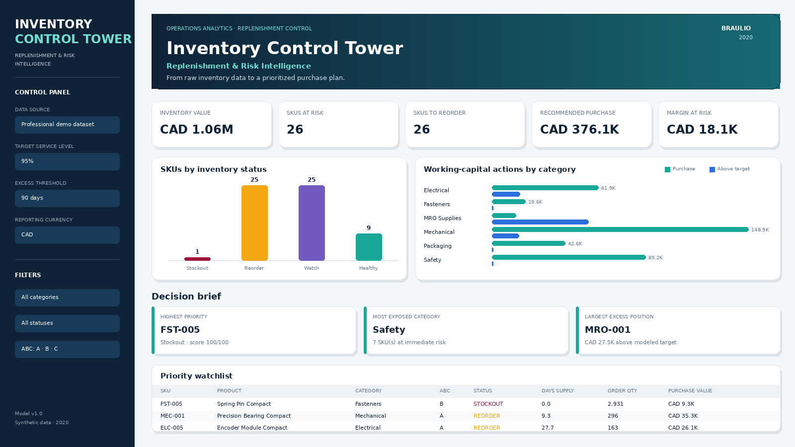
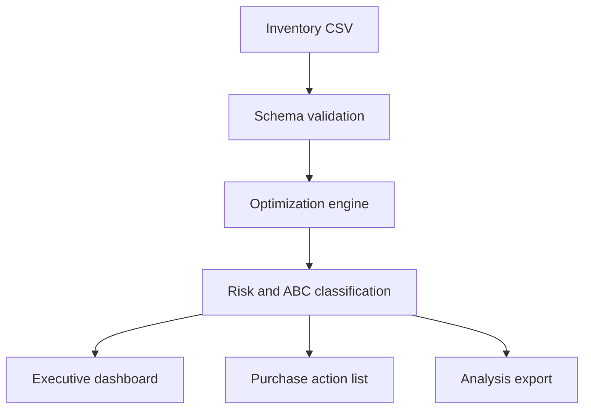

# Inventory Control Tower

## Replenishment & Risk Intelligence



A client-ready Python decision-support application that converts a raw inventory CSV into a prioritized replenishment plan, stockout-risk view, ABC segmentation, and working-capital analysis.

**Built by Braulio · Portfolio demonstration · Synthetic data only**

**Project date: 2020 · Version: 1.0**

## Business problem

Inventory teams often manage reorder decisions in spreadsheets with inconsistent formulas, weak prioritization, and limited visibility into the financial impact of stockouts or excess inventory. This application creates one controlled decision layer that answers four operational questions:

1. Which SKUs require action now?
2. How much should be ordered?
3. Where is margin exposed to a projected shortage?
4. Where is cash tied up above the modeled stock target?

## Delivered capabilities

- CSV upload with schema validation and actionable error messages
- Safety-stock calculation using a configurable target service level
- Reorder point and Economic Order Quantity (EOQ)
- Net inventory position using on-hand, committed, and inbound quantities
- Recommended order quantity and line-level purchase value
- Stockout, critical, reorder, watch, healthy, and excess statuses
- ABC segmentation using annual usage value
- Margin-at-risk and excess-capital estimates
- Executive KPIs, interactive filters, charts, and priority watchlist
- Downloadable reorder action list and full analysis extract
- Automated regression tests and GitHub Actions workflow
- Data dictionary, methodology, assumptions, and client handoff guide

## Validated demo result

At the default 95% service level, the included 60-SKU synthetic dataset produces a fully reconciled management view:

| Measure | Demo output |
|---|---:|
| Inventory value analyzed | CAD 1,062,256.89 |
| SKUs requiring replenishment | 26 |
| Recommended purchase value | CAD 376,128.17 |
| Modeled margin at risk | CAD 18,142.87 |
| Capital above modeled target | CAD 88,139.91 |

These figures demonstrate the workflow and are not claimed client results.

## Application architecture



The calculation engine is independent from the Streamlit interface. It can be reused later in an API, scheduled batch process, or ERP integration without rewriting the business logic.

## Quick start on Windows PowerShell

From the project folder:

```powershell
py -m venv .venv
.\.venv\Scripts\python.exe -m pip install -r requirements.txt
.\.venv\Scripts\python.exe -m streamlit run app.py
```

The application opens in the browser. It starts with a 60-SKU professional demo dataset; upload another CSV from the left control panel when ready.

## Run the regression tests

```powershell
.\.venv\Scripts\python.exe -m unittest discover -s tests -v
```

## Input file

Use [`data/inventory_upload_template.csv`](data/inventory_upload_template.csv) as the starting template. Required fields are:

| Field | Meaning |
|---|---|
| `sku` | Unique item identifier |
| `product_name` | Readable item description |
| `category` | Reporting category |
| `unit_cost` | Landed or standard unit cost |
| `unit_price` | Selling price used for margin exposure |
| `current_stock` | Physical on-hand quantity |
| `avg_daily_demand` | Mean daily consumption |
| `demand_std_dev` | Standard deviation of daily demand |
| `lead_time_days` | Supplier replenishment lead time |
| `order_cost` | Administrative cost per purchase order |
| `annual_holding_rate` | Annual carrying rate as a decimal, such as `0.24` |

Optional fields are `supplier`, `units_on_order`, and `committed_stock`. Missing optional quantity fields default to zero.

See [`docs/DATA_DICTIONARY.md`](docs/DATA_DICTIONARY.md) for complete definitions and calculation logic.

## Core formulas

| Decision measure | Formula |
|---|---|
| Safety stock | service factor × demand standard deviation × √lead time |
| Reorder point | lead-time demand + safety stock |
| EOQ | √(2 × annual demand × order cost ÷ annual holding cost per unit) |
| Inventory position | on hand − committed + inbound |
| Order recommendation | replenish to reorder point + EOQ when inventory position reaches the reorder point |
| ABC class | cumulative annual usage value using 80% / 15% / 5% bands |

## Status logic

| Status | Management interpretation |
|---|---|
| `STOCKOUT` | No uncommitted on-hand inventory remains |
| `CRITICAL` | Inventory position is at or below safety stock |
| `REORDER` | Inventory position is at or below the reorder point |
| `WATCH` | Inventory position is approaching the reorder point |
| `HEALTHY` | Inventory is within the modeled operating range |
| `EXCESS` | Inventory exceeds both the target stock and days-of-supply threshold |

## Project structure

```text
inventory-control-tower/
├── app.py                         Streamlit decision interface
├── inventory_optimizer/
│   └── analysis.py                Validated calculation engine
├── data/
│   ├── sample_inventory.csv       Synthetic 60-SKU demo
│   └── inventory_upload_template.csv
├── tests/
│   └── test_analysis.py           Regression test suite
├── scripts/
│   ├── generate_sample_data.py
│   └── generate_portfolio_cover.py
├── docs/
│   ├── CLIENT_HANDOFF.md
│   ├── DATA_DICTIONARY.md
│   └── UPWORK_CASE_STUDY.md
└── assets/
    └── dashboard_preview.png
```

## Controls and limitations

This is a planning model, not an autonomous purchasing system. Before production use, a client should validate demand history, lead-time definitions, service targets, and cost assumptions. Supplier minimum order quantities, case packs, production capacity, seasonality, expiration constraints, and negotiated order calendars are not included in version 1.0.

## Recommended production roadmap

1. Connect actual ERP inventory, purchase-order, and sales-history tables.
2. Calculate demand variability from transaction history rather than imported summary fields.
3. Add minimum order quantities, case-pack rounding, supplier calendars, and budget caps.
4. Schedule refreshes and publish exception alerts.
5. Record planner decisions and measure stockout reduction, working-capital release, and forecast bias.

## Documentation

- [Client handoff](docs/CLIENT_HANDOFF.md)
- [Data dictionary](docs/DATA_DICTIONARY.md)
- [Upwork case study](docs/UPWORK_CASE_STUDY.md)

---

Copyright © 2020 Braulio. Released as a portfolio demonstration.
