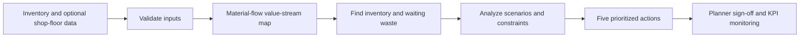

# Lean Manufacturing Extension — Inventory Control Tower

**Status:** owner-requested design requirements only; not implemented or deployed. Current CSV replenishment engine and its validated synthetic-demo outputs remain unchanged.

## Purpose
Use the existing inventory position, ABC segmentation, stockout risk and excess-capital analysis as evidence for manufacturing value-chain waste identification and five prioritized improvement recommendations. Keep decisions planner-approved.

## Proposed workflow

## Lean principles
- Value-stream mapping: supplier/input -> process -> inspection -> delivery/customer, with cycle, queue, waiting and transport times identified per stage.
- Seven wastes (TIMWOOD): transportation, inventory, motion, waiting, overproduction, overprocessing, defects. Optionally track unused talent as an eighth waste.
- Baseline vs target: takt time (available production time/customer demand), cycle time, end-to-end lead time, work in process, first-pass yield, on-time delivery, and process cycle efficiency (value-added time/total lead time).
- Continuous improvement: identify root causes (5 Whys), draft countermeasures, test with PDCA, and standardize only after measurement.
- Human review: recommendations are advisory; never claim realized improvements from hypothetical data.

## Five-recommendation output contract
For each of exactly five prioritized recommendations record: evidence and value-stream stage; waste type; root-cause hypothesis; proposed action; owner; effort, cost and operational risk; implementation window; baseline KPI and target KPI; projected benefit and calculation/assumptions; verification method and measurement date. Rank by expected impact, evidence confidence, feasibility and implementation effort; do not treat an unsupported estimate as measured savings.

## Gate conditions
1. Check input quality and distinguish observed client data from simulations.
2. Build and review an as-is map, then specify a to-be hypothesis.
3. Evaluate safety, quality, capacity, labor and supply constraints before recommending a change.
4. Obtain stakeholder approval before operational execution; preserve audit history.
5. Verify results against the baseline after implementation and revisit if targets are missed.

## Inventory Control Tower-specific integration
- Inventory waste: excess stock, obsolete items, overproduction-driven accumulation and avoidable material handling. Quantify excess units and modeled carrying costs using available inputs.
- Waiting waste: lead-time variability, shortages and late supplier deliveries; infer only where source dates and dependencies exist.
- Pull/flow: evaluate reorder points, EOQ and opportunities for Kanban or smaller replenishment batches; flag that EOQ is not automatically compatible with a pull system.
- Optional manufacturing input fields (not currently part of the required CSV): workstation/stage, material-to-SKU links, daily production demand, cycle and changeover times, WIP, scrap/rework counts, supplier on-time delivery and actual replenishment dates.
- Potential recommended actions: reduce surplus on low-velocity SKUs; prioritize high-risk shortages; investigate unreliable supplier lead times; reduce batch size where cost/capacity permit; pilot controlled point-of-use replenishment.
- Do not assert shop-floor throughput, takt, OEE or actual wait time from an inventory summary alone; report these as not measurable until supporting records exist.
- The public repository must not contain customer-sensitive data, private approvals, or confidential financial models. Use only synthetic examples here.

## Acceptance checks (planned)
- Existing replenishment recommendations and original regression fixtures stay unchanged.
- Each Lean action references one or more evidence rows/SKUs and a measurable target.
- Exactly five distinct recommendations when evidence supports them; otherwise clearly flag missing evidence.
- Never double-count modeled capital release as realized cash or assume financial benefits without holding-cost assumptions.
- No purchase orders or production changes without human approval.
